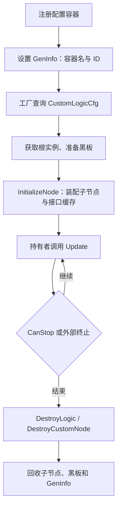

# DSL 配置与执行

[战斗文档导航](../战斗系统与DSL.md) · [返回首页](../../README.md)

## 这里的 DSL 是什么

DSL 是领域专用语言。本项目通过 **C# 方法、配置对象和节点组合** 描述逻辑，属于内部 DSL。当前这条路径不需要先编写一份脚本文本，再经过词法、语法分析器。

例如 `Seq(Log("开始"), Delay(0.1f), Log("结束"))` 表达顺序执行。这里的方法先创建配置对象；日志和等待行为由运行时节点执行。

### 配置与运行时一一对应

| 配置侧 | 运行时侧 | 含义 |
| --- | --- | --- |
| `ILogicConfigContainer` / `LogicConfigBase` | 工厂中的容器注册表 | 以容器名和 ID 定位配置 |
| `CustomLogicCfg` | `CustomLogic` 或其子类 | 一段逻辑的根配置与根实例 |
| `ICustomNodeCfg` | `CustomNode` 或其子类 | 通过 `NodeType()` 指定运行时节点类型 |
| `SequenceBhvCfg` | `SequenceBhv` | 顺序组合 |
| `FTDelayBhvCfg` | `FTDelayBhv` | 有限时长等待 |
| `DelegateBhvCfg` | `DelegateBhv` | 调用配置中的委托 |

[LogicConfigBase.cs](../../Assets/Hotfix/GameLogic/CoreGame/BattleFoundation/LogicDsl/LogicConfigBase.cs) 本身是 `Dictionary<int, CustomLogicCfg>`，并提供 `AddConfig`、`Seq`、`Parallel`、`Delay` 等配置辅助方法。

配置用 **容器名 + LogicConfigID** 查找。技能表 ID 与 DSL 配置 ID 也不是一回事：技能创建代码先从技能表取得 `LogicID`，必要时再由策略替换，最后到技能逻辑容器中查找。

`DefaultLogicType` 默认是 `CustomLogic`。如果调用方要求 `CreateLogic<SkillLogic>`，配置产生的根类型也必须与 `SkillLogic` 相容；容器名仅用于查找配置，不决定实例类型。

### 初始信息、上下文与黑板

| 对象 | 生命周期中的作用 |
| --- | --- |
| `CustomLogicGenInfo` | 容器名、配置 ID、输入黑板及强类型扩展信息 |
| `CustomNodeContext` | 运行时共享引用：GenInfo、根逻辑、黑板、容器、工厂 |
| `VarEnv` | 节点间传递的运行时变量 |
| `CustomLogicCfg.DefaultVarEnv` | 配置提供的缺省值 |

工厂优先使用 `genInfo.PreEnv`；没有输入黑板时从对象池创建。随后调用 `CopyToPreVarEnv`，让特化 GenInfo 写入上下文，再初始化节点。

根配置的缺省黑板在装配时复制到运行黑板，默认跳过已经存在的同类型同 Key 值。因此调用方预先传入的参数可以覆盖配置缺省值。黑板中的引用值按引用复制，指向的业务对象仍由调用方按所有权约定管理。

节点通过 `SetVar<T>`、`GetVar<T>`、`TryGetVar<T>` 访问黑板。`GetVar<T>` 缺值时返回传入的缺省值或 `default(T)`，必要参数应使用 `TryGetVar<T>` 等方式显式检查。

[VarEnv.cs](../../Assets/Hotfix/Framework/CoreGame/CustomLogic/CustomLogic.Base/LogicParts/VariablesLib/VarEnv.cs) 按类型路由存储：普通值类型使用对应桶，引用类型走 `object` 桶，`uint` 使用 `int` 桶路由。部分类型共用存储桶，读写时需要保持 Key 与类型约定一致，数值类型转换应由调用方显式处理。

## 从配置到执行，再到回收

### 注册与装配

[CustomLogicManager.cs](../../Assets/Hotfix/Framework/CorePackage/CustomLogic/CustomLogicManager.cs) 对外提供创建、回收和对象分配入口。`SetRegister` 会立即调用注册器的 `Register`；`AddConfigContainer` 将容器交给工厂。

当前 [LogicCfgContainerRegister_Gameplay.cs](../../Assets/Hotfix/GameLogic/CoreGame/BattleGameplay/LogicDsl/Authoring/LogicCfgContainerRegister_Gameplay.cs) 的 `Register` 为空。创建具体战斗逻辑前，必须先提供并注册对应配置。

[CustomLogicFactory.cs](../../Assets/Hotfix/Framework/CoreGame/CustomLogic/CustomLogic.Base/CustomLogicFactory.cs) 查询容器和配置，按 `NodeType()` 从节点池获取对象，并调用 `InitializeNode`。缺少容器或 ID 时会报错并返回 `null`，调用方不能直接解引用结果。

根逻辑把子节点的更新接口和停止判定接口缓存起来。组合节点负责自己的子节点驱动，因此不是根逻辑每帧把整棵树中所有节点都更新一遍。

`Templete(id)` 保留了源码中的拼写，表示从当前容器引用另一份配置，在装配时展开其节点。当前实现用集合记录已展开 ID，同一根装配过程中重复遇到 ID 也会被拦截，因此同一模板 ID 在该次装配中只能展开一次。

### 节点的激活、开始与更新

[CustomNode.cs](../../Assets/Hotfix/Framework/CoreGame/CustomLogic/CustomLogic.Base/CustomNode/CustomNode.cs) 提供 `InitializeNode`、`Activate`、`Deactivate`、`Reset` 和 `Destroy`。

- 初始化保存上下文并激活节点；组合节点还会调整子节点的激活状态。
- 激活表示节点可以响应输入，不等于业务行为已经执行。
- `BehaviorNodeBase` 在首次 `Update` 时调用 `OnBegin()`，随后调用 `OnUpdate(dt)`。
- `Reset()` 为重复执行恢复状态；`Destroy()` 为对象回收清理状态。

`Update(float dt)` 的返回值是**剩余时间片**。顺序节点可以把前一个节点未消耗的时间交给后一个节点；它不是完成百分比，也不是布尔成功值。

[CustomLogicManager](../../Assets/Hotfix/Framework/CorePackage/CustomLogic/CustomLogicManager.cs) 的模块 `Update` 为空。创建实例不会自动开始持续执行，必须由 System 或其他持有者调用实例的 `Update`。

### 停止与资源所有权

[CustomLogic.cs](../../Assets/Hotfix/Framework/CoreGame/CustomLogic/CustomLogic.Base/CustomLogic.cs) 的 `CanStop()` 检查已缓存、处于激活状态的停止判定节点。只要其中一个不允许停止，就返回 `false`；没有阻止者时可以停止。

`CanStop()` 不负责回收。调用方观察完成或决定中断后，仍要通过服务的 `DestroyLogic`，或直接工厂的 `DestroyCustomNode` 回收实例。

根逻辑回收时会递归回收子节点，并回收其黑板和 GenInfo。因此：

- GenInfo、PreEnv 交给成功创建的逻辑后，不要让其他活动逻辑共享同一个实例。
- 回收根逻辑后，不要继续访问保存的节点、GenInfo 或黑板引用，也不要再次单独回收它们。
- 自定义节点要清理自己持有的状态和订阅，并调用基类清理方法，避免对象池复用时残留数据。
- 工厂 `Dispose()` 清空池和容器，不会替调用方逐一销毁仍在使用的逻辑，应先回收活动实例。

## 常见组合怎么用

| 写法或节点 | 表达的行为 | 使用要点 |
| --- | --- | --- |
| `Seq(...)` | 顺序执行 | 子项应能创建为 `BehaviorNodeBase`；完成后推进下一项 |
| `Parallel(...)` | 同一更新中推进多个行为 | 单线程依次调用各分支，并非多线程任务 |
| `Delay(seconds)` / `Delay(varKey)` | 等待固定值或黑板指定的时长 | 使用传入的逻辑 dt，不是现实时间计时器 |
| `LoopSeq(...)` / `LoopForever(...)` | 重复顺序组合 | 无限循环需要外部终止与回收 |
| `Branch(...)` | 根据条件选择分支 | 具体检查时机应看条件分支节点实现 |
| `WaitCheckBhvCfg` | 等待条件允许结束 | 未满足条件时会阻止停止，需避免永远无解 |
| `FSM(...)` / `CustomState(...)` | 状态及转移组织 | 适合持续模式、AI 或实体状态的组织 |
| `Bhv<T>()` / `Node<T>()` | 接入自定义行为或普通节点 | 行为组合与普通节点的接口要求不同 |
| `SetVarOnBegin` / `SetVarOnInit` | 在不同阶段写黑板 | 区分首次更新与装配阶段 |

顺序执行与根节点列表也不同：根列表中的多个可更新节点并不会自动等待前一个完成。需要先后关系时，明确包进 `Seq`。

普通 `DelegateBhv` 默认在 `OnBegin` 调用一次委托。它没有单独的持续停止约束，需要在 Seq 中持续执行的行为，应同时提供更新逻辑和停止条件。

完整战斗案例见 [施法到清理案例](施法到清理案例.md)。
