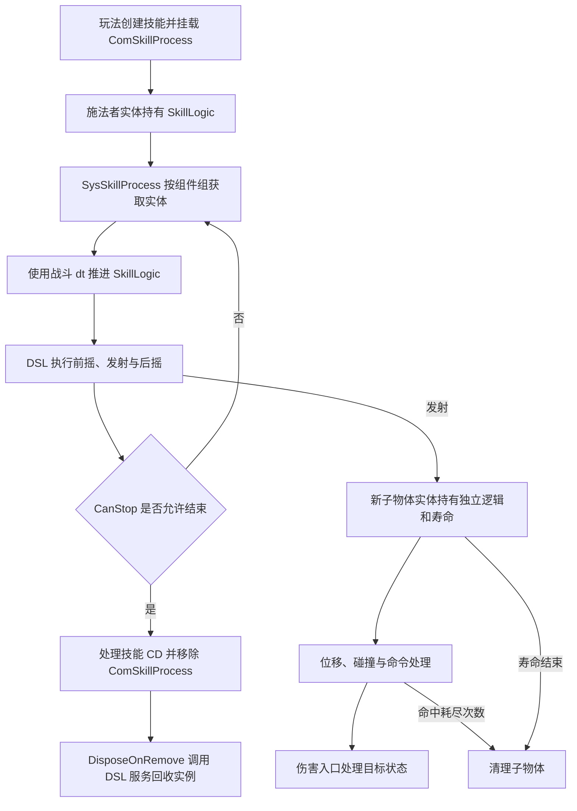

# 为什么使用 DSL 与 Entity

[战斗文档导航](../战斗系统与DSL.md) · [返回首页](../../README.md)

Lcc 用 Entity、Component 和 System 管理战斗对象的状态与更新，用 DSL 组织技能、子物体和 Buff 的执行过程。前者让同类状态有统一的处理入口，后者让不同玩法能够复用时序与行为。两者结合后，调整一个技能的发射过程，通常可以沿用单位管理、时间驱动和回收机制。

本文中的 Entity 指当前框架基于 Entitas 组织的实体体系，与 Unity DOTS 的 Entity、Job System 和 Burst 是不同的技术方案。DSL 指通过 C# 方法、配置对象和节点组合描述逻辑的内部 DSL，配置代码的修改仍需编译，并通过项目的程序集加载流程生效。

## 1. 战斗逻辑增加后，哪些问题会反复出现

从“等待前摇，再发射一颗子弹”开始，用一个方法或状态机就能实现。随后增加连射、攻速变化、命中附加 Buff，多个角色还要复用其中一部分行为，维护工作便会逐渐增加：

- 每个技能分别维护等待时间、阶段索引和结束条件，修正一种时序问题时需要检查多个实现。
- 单位类同时保存移动、施法、Buff、子弹和表现状态，不同能力之间的判断逐渐交织。
- 各对象分别更新，施法、位移、碰撞与表现之间的数据依赖分散在多个回调中。
- 技能结束、子弹消失和目标死亡发生在不同时刻，计时器、订阅与实例容易遗漏清理。

DSL 和实体体系为这些重复问题提供了可复用的组织方式。使用它们的价值取决于项目中有多少相似行为、状态和更新规则需要共同维护。

## 2. DSL：复用行为，组合不同的执行过程

### 时序规则可以复用

前摇、发射、后摇可以组成一个顺序过程；连射则是在其中加入间隔和带条件的后续发射。等待由等待节点处理，先后关系由顺序节点处理，玩法计算放在对应委托或行为节点中。

当多个技能使用同一种等待或顺序规则时，可以共同使用已实现的节点。修改某个技能的前摇参数时，通常不需要修改技能帧驱动系统；修正通用节点时，也有一个明确的实现入口。

现有 [LogicConfigBase](../../Assets/Hotfix/GameLogic/CoreGame/BattleFoundation/LogicDsl/LogicConfigBase.cs) 提供顺序、并行、等待和循环等配置辅助方法。配置是否能够直接组合，还取决于节点接口：例如命中命令节点需要响应命令，不能直接放入只接受行为节点的顺序队列。

### 同一配置可以支持多次独立执行

共享配置描述节点结构和缺省参数，每次创建的运行时实例保存本轮目标、计时与执行进度。两个单位使用同一技能配置时，可以拥有各自的前摇和目标；攻速等动态参数也可以在本次执行的上下文中计算，再交给后续节点使用。

这使技能变化能够通过参数和组合表达，减少为相近技能复制整段流程的需要。使用时必须保持配置与实例状态的边界：本轮剩余时间、目标和进度应保存在运行时节点或黑板中，避免写回共享配置。

### 验证可以围绕节点和组合展开

时序集中在节点组合中后，可以分别检查等待、条件与顺序推进，再验证完整技能。出现“创建成功但没有发射”时，也能沿配置装配、持有者更新、节点激活和首次执行逐层定位。

这种组织有助于缩小检查范围，实际测试仍需要准备节点上下文、输入参数及依赖服务。DSL 的工厂和对象池不会自动验证业务结果，错误的黑板 Key、根类型或停止条件仍会造成运行问题。

配置装配、剩余时间片和黑板规则见 [DSL 配置与执行](DSL配置与执行.md)。

## 3. Entity：组合状态，集中处理同类对象

### 按组件表达对象当前具备的状态

实体提供对象身份，组件保存其状态或运行时引用。例如施法者的 `ComSkillProcess` 持有当前技能实例，子物体用 `ComSubobject` 持有自己的逻辑，寿命由 `ComLife` 表达。

这些能力可以围绕同一个实体组合，减少把各种能力排列成单位继承层级的需要。新增一种独立状态时，可以在组件中表达，再由相关系统消费；使用组件前仍需满足该系统所要求的其他上下文和组件约束。

### System 只处理相关实体

[SysSkillProcess](../../Assets/Hotfix/GameLogic/CoreGame/BattleKernel/World/Systems/Behavior/SysSkillProcess.cs) 获取拥有 `ComSkillProcess` 的实体组，统一推进其中的技能实例。没有执行技能的单位无需进入这一组技能更新逻辑。

统一入口使时间来源、单位时间补偿、完成判定及技能 CD 收尾可以共同维护，各技能继续保留不同的节点组合。组件组也提供了明确的处理对象集合，便于检查某个实体为什么被处理或被排除。

这种分组描述的是筛选与职责组织方式。实际性能取决于实体规模、组件访问和系统实现，需要测量；它本身不代表使用了多线程、连续数据布局或 Burst。

### 更新和清理责任有明确入口

世界装配系统，系统根据接口参与初始化、世界更新、固定更新或关闭流程。新增处理规则时，可以依据数据依赖选择位置，例如先更新逻辑位置，再同步表现。

组件移除也可以承接资源释放。[SkillProcessComponent](../../Assets/Hotfix/GameLogic/CoreGame/BattleKernel/World/LogicWorld/Component/SkillProcessComponent/SkillProcessComponent.cs) 在 `DisposeOnRemove` 中通过 DSL 服务回收技能实例。调用方使用既定的组件移除路径，就能复用这条清理逻辑。

这些入口需要由玩法正确驱动并提供依赖服务。对象池、全局订阅和表现资源仍需按所有权清理，单纯删除一个组件不保证所有关联资源都已释放。更新入口与系统顺序见 [战斗世界与帧循环](战斗世界与帧循环.md)。

## 4. 两者配合：统一驱动，保留玩法差异

以一次技能执行为例，组件连接实体与 DSL 实例，System 决定推进时机，节点组合决定执行内容：

图中的碰撞和命令处理跨固定更新与世界更新，箭头表示调用关系，具体发生时刻取决于世界驱动和事件服务。寿命结束也可以在未命中时独立触发清理。

这个分工允许技能组合发生变化时继续复用帧驱动，也允许系统调整通用驱动规则时继续调用既有的逻辑接口。阅读或排查时，可以先检查实体组件和系统入口，再进入本次技能的节点组合。

技能、子物体与目标分别拥有生命周期。技能后摇结束后，已发射的子弹可以继续飞行；子弹命中后清理，目标则可能仍然存活。取消施法、清屏或关闭世界时，需要明确要终止哪些对象。完整过程见 [最小战斗示例](施法到清理案例.md)。

## 5. 需求变化时，通常改哪里

| 需求 | 优先修改的位置 | 可以继续复用的部分 |
| --- | --- | --- |
| 修改固定前摇 | 技能 DSL 配置中的等待参数 | 技能根类型、组件持有与帧驱动 |
| 按攻速调整前摇和动画 | 本轮参数计算及黑板传递，后续节点读取结果 | 等待节点、顺序组合与更新入口 |
| 增加第二波连射 | 技能组合中的条件、间隔及发射行为 | 单次发射能力、子物体创建与清理流程 |
| 为一个节点保存执行进度 | 运行时节点字段或本轮黑板，并处理 Reset/Destroy | 共享配置与节点工厂 |
| 增加需要多个系统读取的单位状态 | 组件及对应处理系统 | 实体身份与世界管线 |
| 统一调整一类对象的更新规则 | 负责该组件组的 System | 各对象已有的 DSL 配置 |
| 修改伤害计算规则 | 现有伤害入口对应的服务、策略或处理逻辑 | 技能时序与命中命令链路 |

局部行为先尝试已有节点或委托；需要独立状态、明确生命周期或跨配置复用时，再新增节点。组件适合实体层面的状态，节点字段适合某次逻辑内部的执行进度，二者按使用范围选择。

## 6. 适用场景与使用成本

当多个技能共享时序、多个对象组合相似能力，且需要统一驱动与清理时，这套组织方式更容易体现收益。只有一次简单调用的功能，可以直接使用已有委托或服务方法；为它增加新的组件、系统和节点，会增加需要理解和维护的入口。

使用这套机制也需要承担相应成本：

- **装配约定**：容器名、配置 ID、根类型和输入上下文必须匹配，C# 配置仍需要编译。
- **运行时参数**：黑板的 Key、类型和写入时机需要统一约定，必要参数应显式检查。
- **调用链定位**：一次行为可能经过组件、系统、工厂和节点，调试时需同时查看对象状态与执行阶段。
- **顺序依赖**：系统注册阶段和实际更新接口都影响行为，新增系统时需要核对它依赖的数据何时准备完成。
- **复用与回收**：节点的 Reset、Destroy、订阅解绑和引用清理必须完整，尤其需要验证重复执行及中途终止。

DSL 与实体体系提供了复用、分工和定位问题的结构。性能、GC 分配和开发效率的实际变化仍需通过具体项目的测量与使用记录评估。
