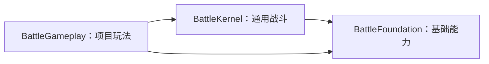
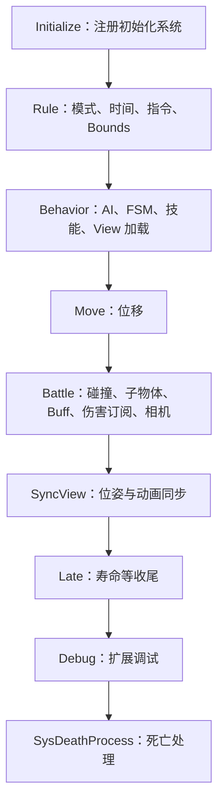

# 战斗世界与帧循环

[战斗文档导航](../战斗系统与DSL.md) · [返回首页](../../README.md)

## 战斗世界如何组织

### 三层依赖



- **Foundation** 放数学、空间结构及 `LogicConfigBase` 等基础能力。
- **Kernel** 放通用系统、组件、战斗节点、上下文和服务接口。
- **Gameplay** 应放具体玩法配置、项目节点、服务实现及世界子类。

此外，`Assets/Hotfix/Framework/CoreGame` 提供战斗之外也能复用的实体世界、`CustomLogic` 和基础节点。DSL 并非只属于某一个技能系统。

内核需要玩法差异时，通过 [BattleKernelCreationInfo.cs](../../Assets/Hotfix/GameLogic/CoreGame/BattleKernel/World/Core/BattleKernelCreationInfo.cs) 注入服务或策略，例如：

| 注入项 | 用途 |
| --- | --- |
| `CustomLogicService` | 创建与回收 DSL 实例 |
| `GameModeGenInfo`、`ModeLogicService` | 模式逻辑的创建与驱动入口 |
| `BattleTimeService` | 战斗时间来源 |
| `SkillFirePolicy`、`SkillLogicOverrideProvider` | 技能创建策略及逻辑 ID 替换 |
| `DamageEventService`、`DamagePolicyService` | 伤害事件接入与规则扩展 |
| `ViewLoadService`、效果和音频服务 | 表现接入 |

接入时按实际调用路径注入服务，并在模式初始化和伤害处理执行前准备好所需的上下文。

### 世界、组件与系统

[ECWorlds.cs](../../Assets/Hotfix/Framework/CoreGame/ECWorld/ECWorlds.cs) 创建 `LogicWorld` 和 `MetaWorld`，装配系统后调用初始化；更新时执行 `Execute()` 与 `Cleanup()`，销毁时调用 `TearDown()` 并重置世界。

`LogicWorld` 管理战斗实体与状态，`MetaWorld` 承载模式等共享上下文。System 根据组件组获取实体，例如 `SysSkillProcess` 只处理拥有 `ComSkillProcess` 的实体，不需要遍历每个对象再判断它能否放技能。

实体持有的是组件，组件可以持有 DSL 实例。以技能为例：

```text
LogicEntity
  └─ SkillProcessComponent
       ├─ SkillTid：技能表 ID
       └─ SkillProcess：这一次技能执行的 CustomLogic 实例
```

同一个配置可以生成多个实例，每个实例拥有自己的执行进度和黑板。不要把剩余时间、当前目标或执行索引写回共享配置。

## 系统注册顺序与帧循环

[BattleKernelWorld.cs](../../Assets/Hotfix/GameLogic/CoreGame/BattleKernel/World/Core/BattleKernelWorld.cs) 按下列阶段注册系统：



这张图表示**系统装配顺序**。实际什么时候执行取决于系统接口：

- `IInitializeSystem.Initialize()` 在世界初始化时执行一次。
- `IExecuteSystem.Execute()` 在世界更新时执行。
- `ITearDownSystem.TearDown()` 在世界销毁时执行。
- `ECSystems` 另行转发 `FixedUpdate`、`LateUpdate` 和 Gizmos。

例如，Rule 阶段注册的 `SysKernelGameModeInitialize` 只执行一次初始化；Battle 阶段注册的 `SysHandleDamage` 在初始化时订阅伤害事件，收到事件后执行处理。

世界 Execute 中，时间和指令先更新，随后推进 AI/FSM 与技能，再执行位移、子物体/Buff 更新、表现同步和生命周期处理。这一顺序使当帧决策能影响位移，表现同步使用更新后的逻辑状态。扩展系统时，应根据所读取和写入的数据确定注册位置。碰撞检测由独立的固定更新入口驱动。

`AddLateSystems` 是注册阶段名称，与 Unity 的 `LateUpdate` 回调不是同一概念；是否走后者仍取决于系统实现的接口。

## 碰撞有独立的固定更新入口

[SysCollision.cs](../../Assets/Hotfix/GameLogic/CoreGame/BattleKernel/World/Systems/Battle/SysCollision.cs) 实现 `IFixedUpdateSystem`，在 FixedUpdate 中同步 Transform 并检测命中；技能和子物体通过世界 Execute 推进。玩法世界需要分别转发 Update 与 FixedUpdate。两种更新入口的调用时序决定碰撞检测到的位置及命中命令的派发时刻，系统注册顺序本身不保证碰撞发生在同一次 Update 的位移之后。

完整战斗案例见 [施法到清理案例](施法到清理案例.md)。

实际世界子类如何补齐模式上下文、注册与注入，见 [玩法接入示例](玩法接入示例.md)。
