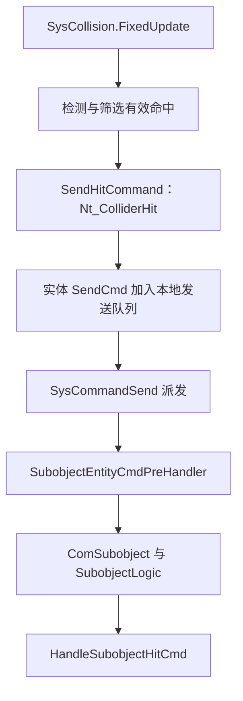

# 施法到清理：一发直线子弹

[战斗文档导航](../战斗系统与DSL.md) · [返回首页](../../README.md)

本例沿现有接口串起“单位施法 → 前摇 → 发射子物体 → 碰撞命令 → 伤害 → 清理”，解释每个配置如何影响运行时。建议先读 [DSL 配置与执行](DSL配置与执行.md)，需要了解调用方职责时参考 [技能、Buff 与扩展](技能Buff与扩展.md)。

这是教学配置与源码调用链，不是仓库中现成可运行的关卡。当前玩法世界、具体配置与注册仍需补齐；以下代码未在 Unity 中编译运行。本例只增加文档，没有写入实际玩法代码或数据表。

## 1. 案例目标与前提

设想施法单位朝目标位置发射一发直线子弹：前摇 0.2 秒，发射后再等待 0.1 秒结束技能；子弹以配置的速度移动，命中一次后结束生命，没有命中则由寿命兜底清理。

这里的“命中一次”指碰撞处理接受的有效命中，不保证一定扣血：闪避、免疫、无敌或其他策略仍可能阻止伤害应用。

运行前需要已有：

- 玩法世界及其 Update、FixedUpdate 转发，完整的模式初始化、玩家/单位上下文和战斗服务注入。
- 可正常创建的施法者与目标，必要的 ID、Transform、HP、阵营、属性、命令及碰撞相关组件和 View。
- 施法者主状态机的 `MainFsmGenInfo`，技能表与子物体表的数据加载，两个 DSL 配置容器的注册。
- 子物体模型、命中特效、碰撞层和挂点，以及能完成加载与反馈的表现服务。

本例沿 `PBConfig.TSkillLogic` 和 `PBConfig.TSubobject` 的现有调用路径解释，不能用名称相近的 Luban 表直接替代这些类型。

## 2. 四个 ID 如何衔接

以下数值只是教学占位值，实际使用前应选择不冲突的 ID 并补齐数据。

| 数据 | 示例值 | 连接关系 |
| --- | --- | --- |
| 技能表 ID | 900001 | 调用 `CreateSkillProcess` 时传入 |
| 技能逻辑 ID | 910001 | 技能表 `LogicID`，在技能容器查找 |
| 子物体表 ID | 920001 | 发射配置读取技能黑板中的子物体 ID |
| 子物体逻辑 ID | 930001 | 子物体表 `LogicID`，在子物体容器查找 |

技能表还应将 `SubobjIds` 的首项设为子物体表 ID，配置 `DamageRate` 等参数。`FillSkillBaseVarEnv` 会把首个子物体 ID 写入 `CV_SpawnSbjTid`，把伤害系数写入 `CV_SkillDmageRate`；后者保留源码中的拼写。

子物体表需准备 `Model`、`During`、`LogicID`、`CollisionType`、`Radius`、`MaxHitCount`、`SingleHitCount`、`HitInterval`、`HitWithLife` 等数据。案例要求 `MaxHitCount = 1`、`HitWithLife = true`，并选择合适的单目标命中次数与间隔；`During` 使用正数，例如 3 秒。碰撞类型需使用当前实现支持的有效枚举值，同时配置可命中的对象。

`During = 0` 在创建代码中会报错并回退到 10 秒，不表示无限寿命，也不表示立刻清理。

## 3. 配置技能与子物体逻辑

下面两个类是教学新增配置，放在 Gameplay 层，并与 `Unity.Hotfix` 编译到同一程序集。两个配置 ID 从构造参数传入；它们不是表 ID。

```csharp
using System.Collections.Generic;

namespace LccHotfix
{
    /// <summary>
    /// 前摇后发射一发子物体，再等待技能后摇结束。
    /// </summary>
    public class ExampleShotConfigs : LogicConfigBase
    {
        /// <summary>
        /// 注册技能根逻辑。
        /// </summary>
        public ExampleShotConfigs(int logicId) : base(LogicContainerKey.LogicConfigs_Skill)
        {
            DefaultLogicType = typeof(SkillLogic);
            AddConfig(logicId, new List<ICustomNodeCfg>
            {
                Seq(
                    Delay(0.2f),
                    FighterSpawnSubobjectTo(CvKey.CV_SpawnSbjTid, CvKey.CV_TargetPos, "Muzzle"),
                    Delay(0.1f))
            });
        }
    }

    /// <summary>
    /// 直线移动、初始化碰撞并响应命中命令的子物体逻辑。
    /// </summary>
    public class ExampleProjectileConfigs : LogicConfigBase
    {
        /// <summary>
        /// 注册子物体根逻辑，命中特效路径由调用方提供。
        /// </summary>
        public ExampleProjectileConfigs(int logicId, string hitFxPath) : base(LogicContainerKey.LogicConfigs_Subobject)
        {
            DefaultLogicType = typeof(SubobjectLogic);
            AddConfig(logicId, new List<ICustomNodeCfg>
            {
                Subobject_SetLocomotionStraightDir(10f),
                Subobject_InitColliderByPbCfg(),
                HandleSubobjectHit(hitFxPath)
            });
        }
    }
}
```

在玩法注册器已有的 `Register(ICustomLogicService service)` 方法中注册两个容器。例如：

```csharp
service.AddConfigContainer(new ExampleShotConfigs(910001));
service.AddConfigContainer(new ExampleProjectileConfigs(930001, "Example/HitFx"));
```

`Example/HitFx` 是资源路径占位符，必须替换成实际可解析的命中特效地址。不要对同一服务重复注册同名容器；正式已有技能或子物体容器时，应把示例配置加入原容器，而不是再注册一份。

### 配置如何影响行为

| 配置 | 运行时结果 |
| --- | --- |
| `DefaultLogicType = typeof(SkillLogic)` | 工厂创建具备技能协议的根实例 |
| 技能根下的 `Seq` | 前摇结束才发射，发射后才执行后摇 |
| `Delay(0.2f)` | 消耗技能收到的逻辑时间；不是现实时间计时器 |
| `CV_SpawnSbjTid` | 从技能表填入的黑板读取子物体表 ID |
| `CV_TargetPos` | 读取目标位置，作为本次发射的方向依据 |
| `Muzzle` | 从施法者 View 的该挂点取初始位置，需提供有效挂点 |
| `Delay(0.1f)` | 约束技能结束时间，不等待子弹命中 |
| `Subobject_SetLocomotionStraightDir(10f)` | 初始化直线位移、速度与朝向；默认投影到 XZ 平面 |
| `Subobject_InitColliderByPbCfg()` | 首次更新时按子物体表设置 Bounds、碰撞和相关变量 |
| `HandleSubobjectHit(hitFxPath)` | 注册常驻命中命令处理节点，收到命中命令才处理效果 |

子物体根列表故意不包 `Seq`：`HandleSubobjectHit` 是 `CustomNode` 命令处理节点，不是 `BehaviorNodeBase`，不能塞进行为队列。移动设置是初始化阶段委托，碰撞设置是首次更新委托，命中处理则持续响应命令。

本例是朝一个已取得的位置直线发射，不会因为目标后来移动就自动追踪它；2D XY 项目也应按自己的战斗平面调整位移配置，不能直接照用默认 XZ 逻辑。

## 4. 施法：从表数据创建运行时

已有主状态机节点在决定施法时，调用 [CustomNodeSkillExtensions](../../Assets/Hotfix/GameLogic/CoreGame/BattleKernel/LogicDsl/NodeExtensions/CustomNodeSkillExtensions.cs) 的 `CreateSkillProcess`，传入施法实体、技能表 ID、合法目标、伤害类型和攻击次数。

这一步必须处于正确的 `MainFsmGenInfo` 上下文，不能在普通空节点上调用后期待自动补齐世界与单位信息。

```text
CreateSkillProcess：技能表 ID 900001
  → SkillFirePolicy 判断是否允许创建
  → 读取 TSkillLogic.LogicID：910001（策略可重写）
  → 填入技能系数、子物体 ID 与目标等黑板
  → 构造 SkillLogicGenInfo
  → 技能容器查找 910001，创建 SkillLogic
  → 挂到施法者 ComSkillProcess
```

[SysSkillProcess](../../Assets/Hotfix/GameLogic/CoreGame/BattleKernel/World/Systems/Behavior/SysSkillProcess.cs) 开始推进实例。前摇节点没结束时，顺序节点阻止发射行为执行；前摇消耗完毕后，把剩余时间片交给发射节点，因此发射与后摇起步可能发生在同一次更新。

## 5. 发射：技能创建另一份独立逻辑

[SpawnSubobjectToTargetBhv](../../Assets/Hotfix/GameLogic/CoreGame/BattleKernel/LogicDsl/Nodes/Skill/SpawnSubobjectToTargetBhv.cs) 在 `OnBegin` 读取目标位置、起始挂点和子物体表 ID，为子物体分配新的输入黑板，写入 `CV_SbjTargetPos`。

[CustomNodeSubobjectExtensions](../../Assets/Hotfix/GameLogic/CoreGame/BattleKernel/LogicDsl/NodeExtensions/CustomNodeSubobjectExtensions.cs) 随后解析子物体表的模型、逻辑 ID 和寿命，创建实体、命令发送组件及 `SubobjectLogic`，挂到 `ComSubobject`，并添加 `ComLife`。

这是新的根逻辑与黑板，不是把技能根直接交给子弹。`FillSubobjectBaseVarEnv` 有选择地传递技能 ID、伤害系数和伤害类型等值；不会无条件复制技能的所有黑板变量。新增自定义参数时应确认传递点，必要时使用发射配置的 `WithSubobjVar`。

子物体自己的直线位移与碰撞初始化完成后，由世界的位移、固定碰撞更新及相关服务共同驱动。技能继续消耗自己的 0.1 秒后摇，子物体则可以在技能结束后继续存活。

## 6. 命中：从碰撞到 DSL 命令节点



[SubobjectColliderHandlerBase](../../Assets/Hotfix/GameLogic/CoreGame/BattleKernel/World/LogicWorld/Component/ColliderComponent/Collider/SubobjectColliderHandlerBase.cs) 负责次数、间隔等过滤，并把 `HitInfo`、命中是否消耗生命及剩余次数写入命令。

`SendCmd` 是入队，不能把“检测到了碰撞”直接当成“已执行命中节点”。[CommandSenderComponent](../../Assets/Hotfix/GameLogic/CoreGame/BattleKernel/World/LogicWorld/Component/CommandSenderComponent/CommandSenderComponent.cs) 的本地派发经由 [SysCommandSend](../../Assets/Hotfix/GameLogic/CoreGame/BattleKernel/World/Systems/Rule/SysCommandSend.cs) 推进。`SubobjectLogic` 继承 `EntityCmdLogic`，后者缓存并调用激活的命令处理节点。

[HandleSubobjectHitCmd](../../Assets/Hotfix/GameLogic/CoreGame/BattleKernel/LogicDsl/Nodes/Subobject/HandleSubobjectHitCmd.cs) 区分障碍物与实体命中，处理表现及可选的 Buff/AOE，再对有效目标构造伤害事件。命中障碍物会走对应表现和寿命处理，不会沿单目标实体分支执行伤害。

碰撞走 FixedUpdate，命令派发和技能推进属于世界更新；完整时序应结合玩法的两种更新转发判断，不能假设全部在同一次 Update 中完成。

## 7. 伤害：命中成立不等于扣血成立

`ExecuteHitEffect` 用当前子物体根逻辑和目标构造 `EvtDamage`，读取攻击来源与技能系数，随后交给 `DamageEventService.DispatchDamage`。

[SysHandleDamage](../../Assets/Hotfix/GameLogic/CoreGame/BattleKernel/World/Systems/Battle/SysHandleDamage/SysHandleDamage.cs) 已在初始化时注册处理函数：计算结果后交给 [DamageHandler](../../Assets/Hotfix/GameLogic/CoreGame/BattleKernel/World/Systems/Battle/SysHandleDamage/Handlers/DamageHandler.cs) 应用，再记录并派发伤害后事件。服务实现决定事件何时送达处理函数。

`DamageHandler` 依次检查目标状态、可受伤属性、Buff 和策略，并处理闪避、格挡、免疫及无效数值；真正执行扣血时，将最终伤害向下取整后调用 `ChangeHP`。因此不能把表中的 `DamageRate` 当成固定扣血值，也不能凭收到命中通知就断言 HP 必然下降。

若 HP 从正数跨到零或以下，[BattleDeathTransition](../../Assets/Hotfix/GameLogic/CoreGame/BattleKernel/World/LogicWorld/Component/HpComponent/BattleDeathTransition.cs) 派发死亡边沿通知，允许状态机或濒死机制介入。是否进入死亡组件与后续死亡表现，还取决于目标自己的处理协议。

## 8. 清理：三条独立的生命周期

| 对象 | 结束条件 | 回收路径 |
| --- | --- | --- |
| 施法者的技能实例 | 顺序完成，或技能被外部终止 | SysSkillProcess 移除 ComSkillProcess → DisposeOnRemove → DestroyLogic |
| 发射出的子物体 | 有效命中耗尽生命，或寿命结束等 | 添加 ComDeath → SysDeathProcess → ComSubobject.DestroyLogic 与实体清理 |
| 被命中的目标 | 扣血触发死亡协议，且未被保护机制恢复 | 目标自己的死亡处理 → ComDeath/死亡逻辑 → SysDeathProcess |

本例命中时，`HandleHitLife` 仅在 `keepAliveOnHit` 为 false、命中消耗生命且剩余次数不大于零时，移除寿命并添加死亡组件。穿透、保活或不消耗生命会改变该行为。

若未命中，由 `SysLife` 更新寿命：当前实现先判断 duration，再扣减；因此一次扣减刚跨过零时，通常在后续执行中才标记死亡，不应宣称恰好在指定秒数销毁。

[SysDeathProcess](../../Assets/Hotfix/GameLogic/CoreGame/BattleKernel/World/Systems/Late/SysDeathProcess.cs) 在有死亡逻辑时先推进该逻辑，允许停止后才清理。清理子物体时显式回收其 DSL；根逻辑进一步回收子节点、GenInfo 与黑板。View、特效等资源仍应由对应组件或服务履行自身释放责任。

结束技能不会自动撤销已经发射的子弹；销毁子弹也不意味着目标死亡。实现取消施法、清屏等需求时，应明确要终止哪一种对象。

## 9. 如何逐段验证

在补齐玩法后，可沿下表设置断点或临时日志。以下为验收步骤，尚未实际执行。

| 阶段 | 检查内容 |
| --- | --- |
| 创建 | 技能表 ID 与逻辑 ID 映射正确；根实例是 SkillLogic；黑板目标有效 |
| 前摇 | 累计逻辑时间不足 0.2 秒时不发射，跨过后只生成一发 |
| 发射 | 子物体表和逻辑 ID 正确；新实体有 ComSubobject、ComLife 及有效碰撞初始化 |
| 命中 | 先收到 Nt_ColliderHit，再到命中处理节点；不存在重复的非预期有效命中 |
| 伤害 | DamageContext 来源与目标正确，处理函数被调用，扣血符合最终计算结果 |
| 技能清理 | 后摇完成移除 ComSkillProcess，子物体仍可独立存活 |
| 子物体清理 | 一次有效命中耗尽生命后清理；未命中也能经寿命结束清理 |
| 目标与边界 | 非致死、致死、免疫、目标消失、障碍物命中及中途销毁都走各自处理路径 |
| 再次施放 | 新实例没有上次的计时、目标、命中次数和池对象状态残留 |

建议按“创建与计时 → 发射与位移 → 碰撞与命令 → 伤害 → 三条回收路径”逐段验证，先定位最早断开的环节，再排查后续节点。

本篇使用教学配置串联流程；参考项目中更复杂的前摇、连射、穿透与 DOT 实现，见 [技能与 Buff 示例](技能与Buff示例.md)，玩法世界接入见 [玩法接入示例](玩法接入示例.md)。
